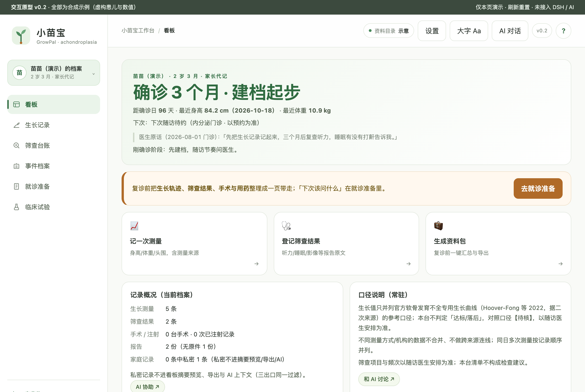
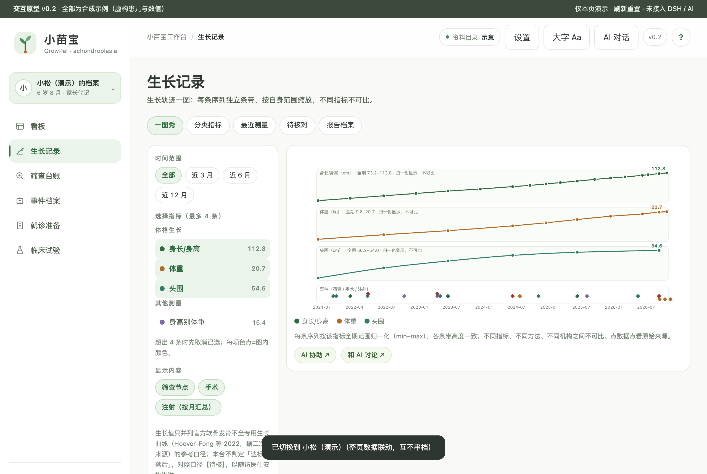
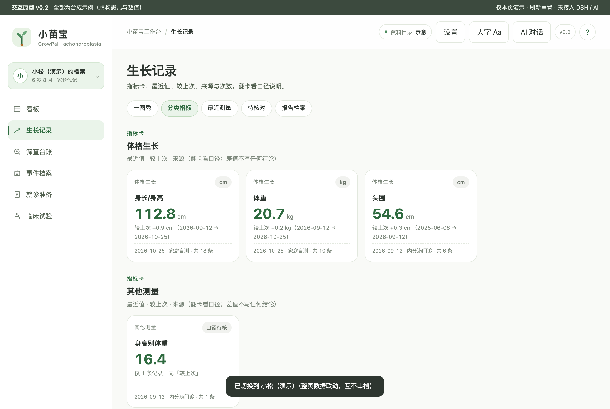
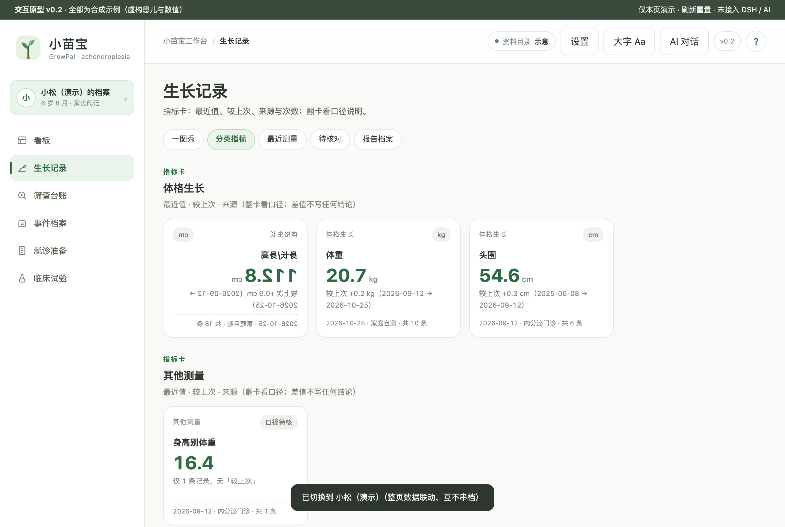
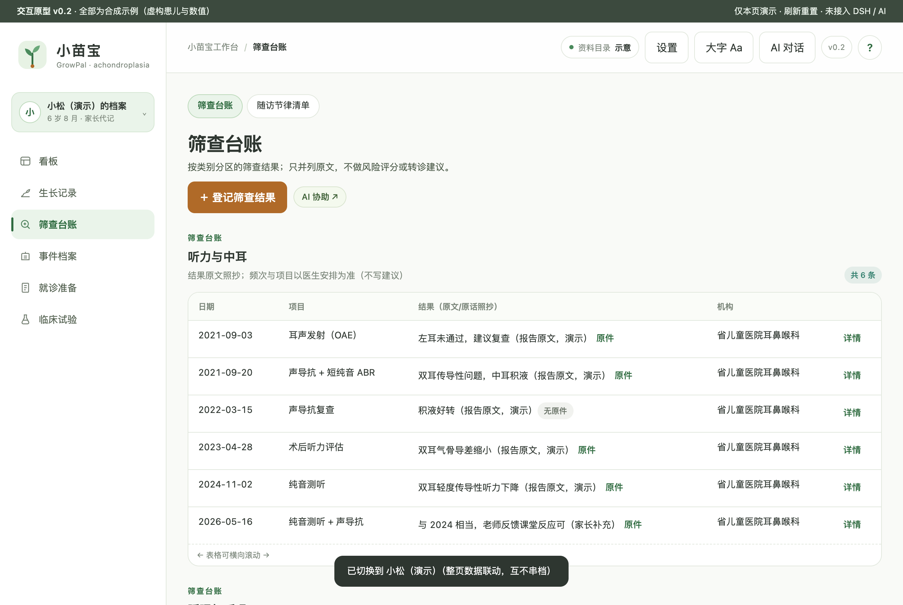
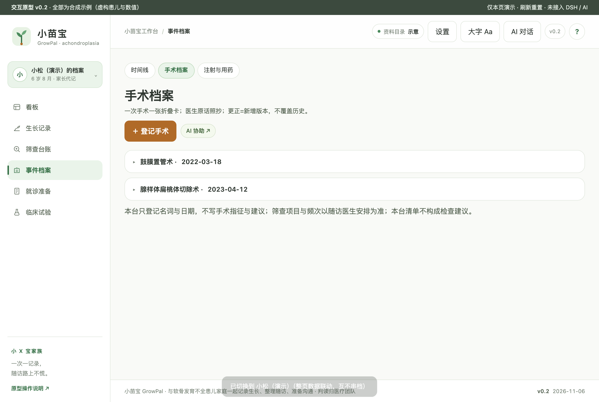
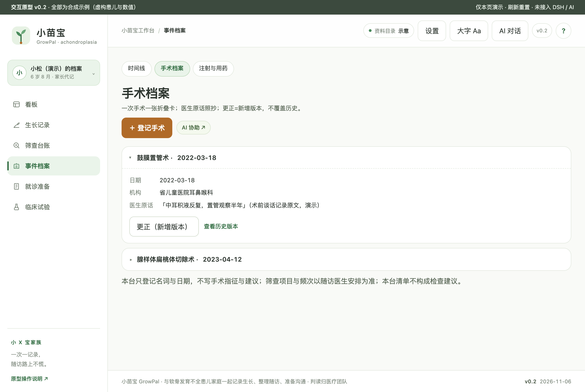
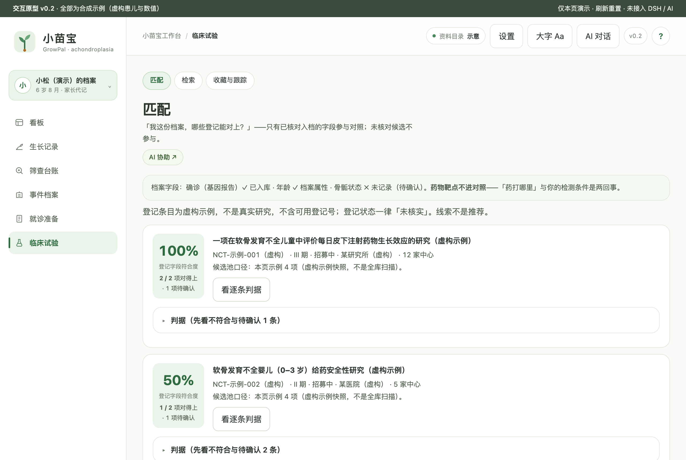
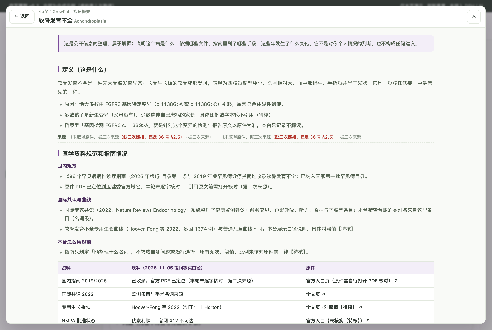
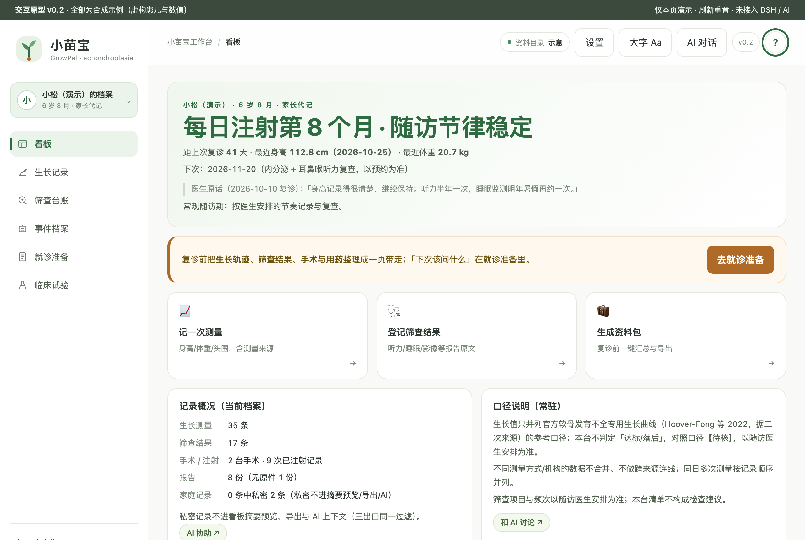

# 小苗宝 GrowPal · 软骨发育不全患儿家庭工作台

小 X 宝家族 R3（儿童/遗传型）样板 · 交互原型 v0.2。服务软骨发育不全患儿家庭（家长代记为主）：生长记录、筛查台账、手术与注射事件、就诊准备、登记线索。

**状态：交互原型阶段（未接入 DSH 宿主 / 未接入 AI / 未接入 MinerU）。全部数据为合成示例。0 患者访谈、0 临床审核（见 [docs/USER-RESEARCH.md](docs/USER-RESEARCH.md)）。**

## 疾病概要

软骨发育不全（Achondroplasia）是 FGFR3 基因变异引起的先天骨骼发育异常（常染色体显性遗传，多为新生变异），表现为四肢短缩型矮小、大头、三叉戟手；国家罕见病目录收录，随访围绕生长监测与并发症筛查（听力、睡眠、颅颈、脊柱、下肢）。背景资料见工作台顶栏「?」（整页四段，逐条带来源）；本台只整理事实，不判读。

## 关键功能

**看板**：大字状态 + 医生原话 + 行动带 + 快捷卡三连；记录概况含「N 条中私密 M 条」口径。

**生长记录 · 一图秀**：每条序列独立条带、按该指标全期范围归一化并标注「不可比」；时间范围/指标（最多 4 条）/事件层三节 rail；点数据点回看原始来源。

**分类指标卡**：真 3D 翻转（定高 194px，翻面是口径说明与「仅回顾不解读」；差值不写任何结论）。

**筛查台账**：按听力/睡眠/颅颈/脊柱/下肢分区的结果原文台账；频次与项目以医生安排为准。

**事件档案**：手术/注射折叠卡（打印全展开），医生原话照抄，更正=新增版本。

**临床试验**：登记快照 + 候选线索（n/m 项对得上 · k 项待确认 + 逐条判据三态；无匹配指数与判读列；示例条目为虚构）。

**疾病概要（?）**：整页四段（定义→规范与指南→治疗全景→趋势），逐条来源 + 固定免责。

**就诊准备**：资料包预览整页视图 + 导出（私密三出口过滤 + 家长代记标记）+ 待问清单。

## 怎么用

1. 双击打开 `prototypes/v0.2/index.html`（或 dev-server 提供）。
2. 侧栏上方切换两套演示档案：**A 苗苗（刚确诊记录少）/ B 小松（长期随访记录多）**，整页联动。
3. 「AI 协助 ↗」是 `achondroplasia:agent-draft` 协议链接：嵌入式（壳层 iframe）直接发送提示词+上下文；独立打开走演示面板（不假装发送）。
4. 顶栏「?」打开疾病概要；「设置」含工作区 / 文档解析（MinerU，未接入如实标注）/ 临床数据库三页签。

## 数据与口径

- 演示数据唯一源：`prototypes/v0.2/demo-data.js`（合成示例，页面不写死数字）。
- 口径：仅回顾不解读；不同方法/机构不合并；判读归医生；生长对照值【待核】（Hoover-Fong 2022 口径，据二次来源）。
- 私密三出口（看板摘要/导出/AI 上下文）共用同一过滤函数；儿童数据隐私默认更严（R3）。
- 真实数据：装机后由 DSH 宿主指定资料目录（`config.root = dshHomePath('achondroplasia')`），拒绝主目录/桌面/下载根。

## 开发

- 检查链：`npm run check`（staticPass + 探针覆盖 + 链接断言全绿）；家族一致性：`npm run audit`；一键 `npm run release:check`。
- 项目探针：`node scripts/probe-ach-m2.mjs`（IP/X/C/MT/A/P/Q 组 16 项实测）；36 号探针 `node scripts/probe-disease-primer.mjs --url <原型地址>`；32 号探针 `node scripts/probe-page-view.mjs`（examples 参考件）。
- 版本 v0.2（版本号/CHANGELOG/README/截图四处同源）；夜班进度见 [PROGRESS.md](PROGRESS.md) 与 [docs/DEV-PLAN.md](docs/DEV-PLAN.md)。
- 家族基准：小粉宝（breast-cancer v0.4，元素）+ 小橙宝（aml v0.2，结构）+ cervical（客户端链路底本）；只抄结构不抄病种语义。
- 需要 Node.js 22+；`npm run check` 只保证「能装」（第一天就该绿）；`npm run audit` 管「还是不是家族里的一员」，交付前必须清零。
